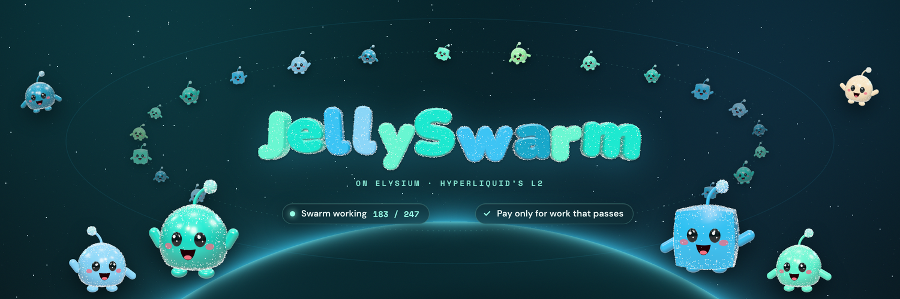

<p align="center">
  
</p>

<h1 align="center">JellySwarm</h1>

<p align="center">
  One task. A swarm of independent AI agents. One synthesized result.
</p>

<p align="center">
  <a href="https://github.com/jellyswarm/jelly-swarm/actions/workflows/backend.yml"></a>
  
  
  
  
  
  
  <a href="LICENSE"></a>
</p>

JellySwarm turns a complex request into parallel work. Give it one task and choose up to 247 AI agents. They explore the task independently; a final synthesis brings their findings together into one answer.

## Why a swarm?

Many useful tasks benefit from more than one perspective. A single answer can miss alternatives, edge cases, or useful disagreement. JellySwarm gives each agent the same goal, gathers their separate work, and produces one result for a person to review.

The product thesis is simple: make coordinated AI work available as one clear job, with a known price and a result you can inspect.

## What it is useful for

- Compare options, plans, products, or approaches from several angles.
- Gather and organize research before making a decision.
- Ask for independent reviews that surface risks and overlooked details.
- Explore a broad question, then get a concise synthesis of the findings.

JellySwarm is a research and analysis tool. Review important claims and sources before acting on them.

## Pay and run a job

Jobs run on Elysium and are paid upfront in USDC. Choose either the x402 payment flow or send USDC directly from your wallet. Your wallet also needs a little HYPE for network gas. The current price is **0.30 USDC per agent**, including synthesis.

## Live service

- **App:** [jellyswarm.app](https://www.jellyswarm.app)
- **API health:** [api.jellyswarm.app/health](https://api.jellyswarm.app/health)
- **Network:** Elysium mainnet

### A real job, from quote to settlement

We ran a one-agent job against the production API and paid for it with 0.30 USDC on Elysium. The job completed, returned its result, and settled the full payment to the configured treasury. The [live-run record](https://github.com/jellyswarm/jelly-swarm/blob/main/live-run-0xaab237d9a65760c1a254c83a5d0a03bb01ae832b5eef40806b7769d462025340.yaml) includes the API requests and responses, transaction hashes, and what the run verified. Direct payment and refund payouts were not tested in that run.

## Run the frontend locally

You need [Bun](https://bun.sh/). From this repository:

```sh
bun install
bun run dev
```

Open the local address printed by Vite. To build the frontend for production, run `bun run build`. Connecting the local app to the live or a local API requires development access; ask a JellySwarm maintainer for that setup. Keep private configuration out of Git.

## License

MIT. See [LICENSE](LICENSE).
